# Installing CBUS Workbench

This guide covers installing, updating and uninstalling CBUS Workbench (CW) on
Windows, macOS and Linux. Release builds include everything CW needs, including
the module descriptor (MDF) collection, so you do not need Python or other
development tools.

To run CW from source instead, see the [README](../README.md#running-from-source).

## Contents

- [Download a release](#download-a-release)
- [Windows](#windows)
- [macOS](#macos)
- [Linux](#linux)
- [Your data](#your-data)
- [Troubleshooting](#troubleshooting)

## Download a release

Download CW only from the project's
[GitHub Releases](https://github.com/jimmythedog/cbus-workbench/releases) page.

1. Choose a release. Early test versions are marked **Pre-release** and have
   versions ending in `a1` (alpha), `b1` (beta) or `rc1` (release candidate),
   e.g. `0.1.0a1`. Pre-releases may contain bugs; copy your data folders before
   trying one (see [Your data](#your-data)).
2. Expand **Assets** and download the file for your computer, where `<version>`
   is the release version:

   | Computer | Installer | Portable (no installation) |
   | --- | --- | --- |
   | Windows (64-bit) | `cbus-workbench-<version>-windows-x64-setup.exe` | `cbus-workbench-<version>-windows-x64-portable.zip` |
   | Mac with Apple silicon (M1, M2, …) | `cbus-workbench-<version>-macos-arm64.dmg` | `cbus-workbench-<version>-macos-arm64-portable.zip` |
   | Mac with Intel processor | `cbus-workbench-<version>-macos-x64.dmg` | `cbus-workbench-<version>-macos-x64-portable.zip` |
   | Ubuntu 24.04 or newer (64-bit) | `cbus-workbench-<version>-linux-x64.deb` | — |
   | Other Linux (64-bit) | — | `cbus-workbench-<version>-linux-x64-portable.zip` |

   On a Mac, **Apple menu → About This Mac** shows **Chip** (Apple silicon) or
   **Processor** (Intel). The **Source code** archives are not needed.

Use the installer unless you need a copy that runs without being installed. A
portable copy is a folder (or, on macOS, an app) that you extract from the zip
and run directly; to update it, replace it with the newer one, and to remove it,
delete it. The Windows and macOS security steps below apply to portable copies too.

The Windows and macOS builds are not signed by a recognised publisher, so both
systems warn before running CW for the first time. Only continue if you
downloaded CW from the Releases page above.

## Windows

### Install

1. Run `cbus-workbench-<version>-windows-x64-setup.exe`.
2. Microsoft Defender SmartScreen may show **Windows protected your PC**. Select
   **More info**.

   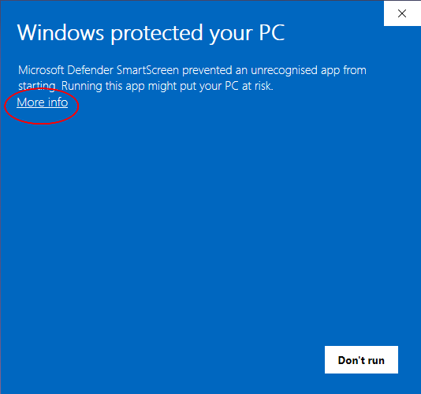

3. Check that **Application** shows the CW installer you downloaded, then select
   **Run anyway**. **Publisher** shows **Unknown publisher** because the
   installer is not signed. Do not turn off SmartScreen.

   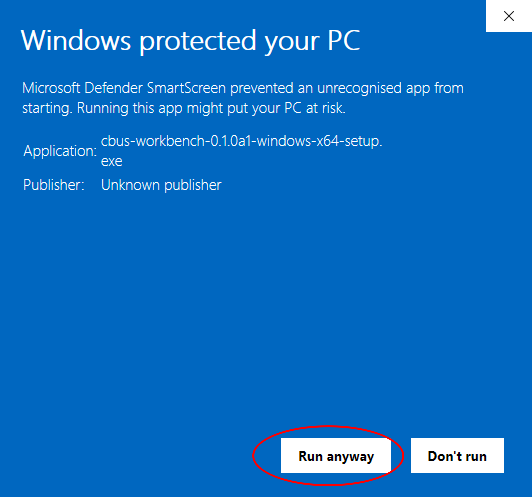

4. CW installs for all users, so Windows asks for administrator permission.
   Choose **Yes**.
5. Under **Select Destination Location**, keep the default folder,
   `C:\Program Files\CBUS Workbench`, and select **Next**.

   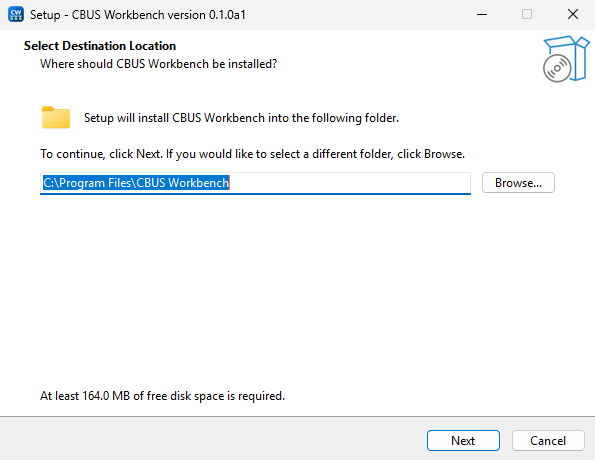

6. Under **Ready to Install**, select **Install**.

   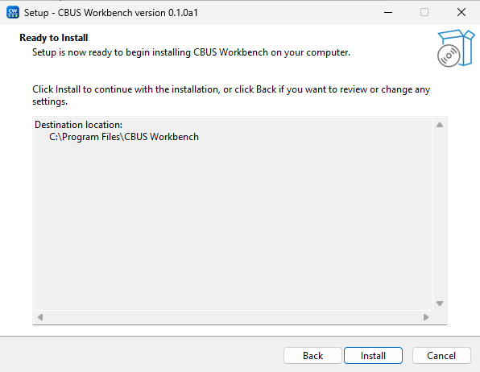

7. Leave **Launch CBUS Workbench** ticked to start CW now, and select **Finish**.

   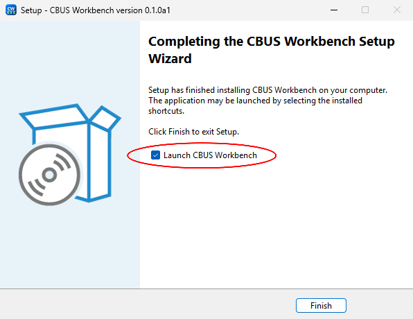

Afterwards, start CW from **CBUS Workbench** in the Start menu.

### Update

Close CW, then download and run the newer installer. It reuses the existing
folder and replaces the previous version; you do not need to uninstall first.

### Uninstall

Close CW. Open **Settings → Apps → Installed apps**, find **CBUS Workbench**,
select **⋯** and then **Uninstall**. (On Windows 10: **Settings → Apps → Apps &
features**.) Your data is kept; see [Your data](#your-data).

## macOS

### Install

1. Open the downloaded `.dmg` file. Drag **CBUS Workbench** onto the
   **Applications** folder in the window that opens.

   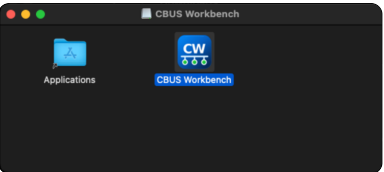

2. Eject the **CBUS Workbench** disk image, then open **CBUS Workbench** from
   your Applications folder.
3. Because CW is not signed with an Apple Developer ID or notarised by Apple,
   macOS shows **“CBUS Workbench” Not Opened**. Choose **Done**, not **Move to
   Trash**.

   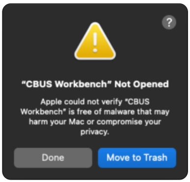

4. Open **System Settings → Privacy & Security** and scroll down to **Security**.
   Beside **“CBUS Workbench” was blocked to protect your Mac.**, choose **Open
   Anyway**. This allows only this copy of CW; leave the **Allow applications
   from** setting unchanged.

   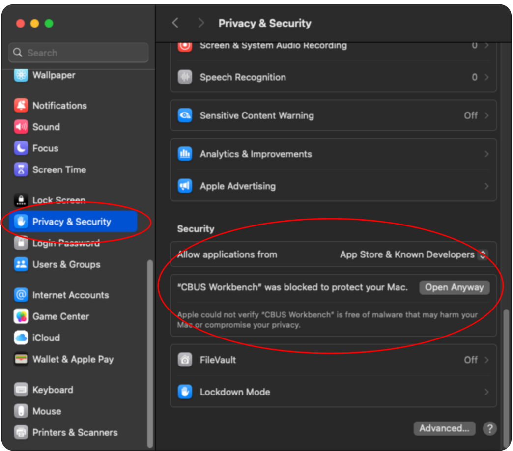

5. In the **Open “CBUS Workbench”?** dialog, choose **Open Anyway**.

   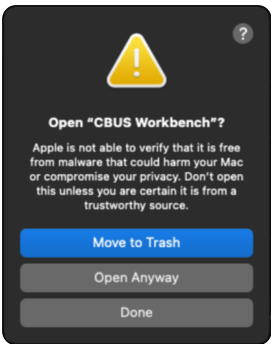

6. If asked, enter an administrator's username and password, and choose **OK**.

   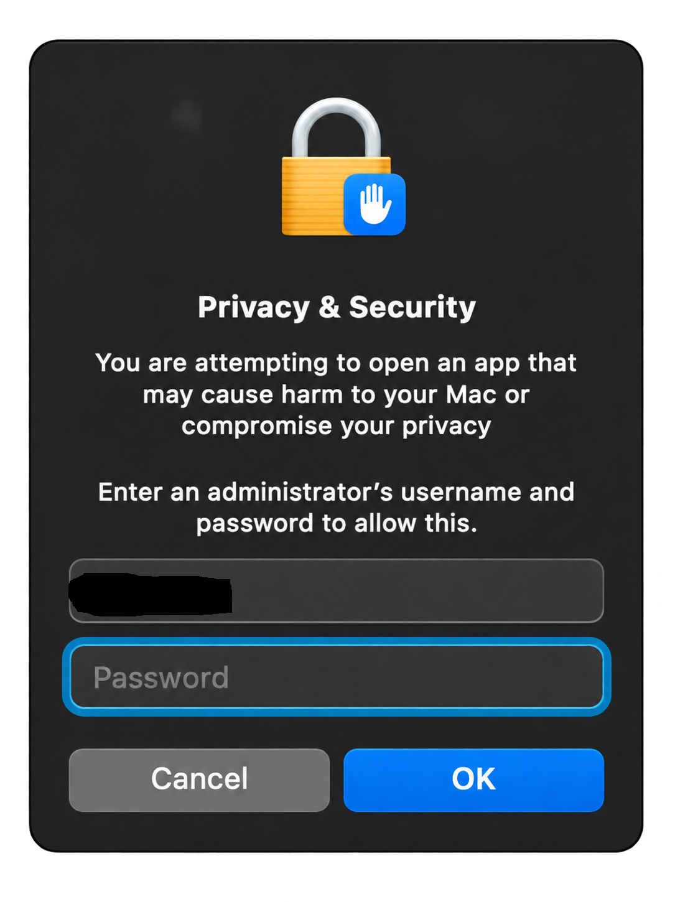

CW now opens. From now on, open it normally from Applications.

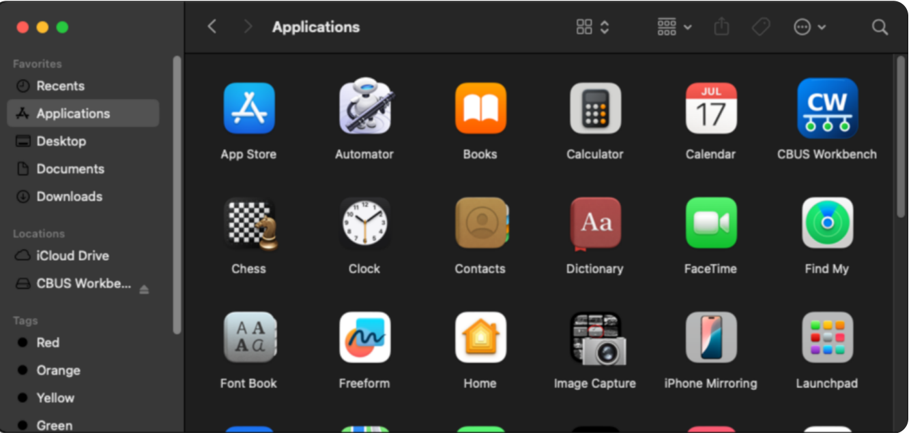

The screenshots are from a recent version of macOS; wording may differ slightly
on other versions.

### Update

Quit CW. Open the newer `.dmg`, drag **CBUS Workbench** onto **Applications** and
choose **Replace**. macOS may ask you to approve the new copy again, as in steps
3–6 above.

### Uninstall

Quit CW, then drag **CBUS Workbench** from your Applications folder to the Trash.
Your data is kept; see [Your data](#your-data).

## Linux

### Ubuntu 24.04 or newer (`.deb`)

Install from the directory containing the download:

```sh
sudo apt install ./cbus-workbench-<version>-linux-x64.deb
```

Start **CBUS Workbench** from the application menu, or run:

```sh
cbus-workbench
```

To use a USB serial CAN interface, add yourself to the `dialout` group, then log
out and back in:

```sh
sudo usermod -aG dialout $USER
```

To **update**, install the newer `.deb` with the same `apt install` command. To
**uninstall**:

```sh
sudo apt remove cbus-workbench
```

Removing the package keeps your data; see [Your data](#your-data).

The package is tested on Ubuntu 24.04. Other Debian-based distributions with
glibc 2.39 or newer, such as Debian 13, may work but are untested.

### Other distributions (portable zip)

The portable build needs glibc 2.39 or newer, plus the system's OpenGL/EGL, X11
(xcb, including `libxcb-cursor`) and Wayland libraries.

```sh
unzip cbus-workbench-<version>-linux-x64-portable.zip
cd cbus-workbench-<version>-linux-x64-portable
./"CBUS Workbench"
```

To **update**, delete the old folder and extract the newer zip. To **uninstall**,
delete the folder. Your data is kept; see [Your data](#your-data).

For serial access, add yourself to your distribution's serial-port group
(`dialout` on most).

### NixOS

The release builds are not tested on NixOS and will not run directly, because
they expect system libraries in standard Linux locations. A compatibility layer
such as `nix-ld` or `steam-run` may work but has not been validated. Running from
source is described in the
[development guide](development.md#nixos-development).

## Your data

Updating or uninstalling CW never deletes your layouts, backups, annotations,
settings, user MDFs or logs. They are stored in your user account, separately
from the application, and are used again if you reinstall.

**Help → Application Directories…** shows where they are on your computer. The
usual locations are:

| System | Locations |
| --- | --- |
| Windows | `%APPDATA%\cbus-workbench` and `%LOCALAPPDATA%\cbus-workbench` |
| macOS | `~/Library/Application Support/cbus-workbench`, `~/Library/Preferences/cbus-workbench` and `~/Library/Caches/cbus-workbench` |
| Linux | `~/.config/cbus-workbench`, `~/.local/share/cbus-workbench`, `~/.local/state/cbus-workbench` and `~/.cache/cbus-workbench` |

### Complete removal

> [!WARNING]
> This permanently deletes all your CW layouts, node backups, annotations,
> settings, user MDFs and logs. It cannot be undone. Copy anything you want to
> keep first.

1. Uninstall CW as described above.
2. Delete each of the folders listed for your system, if present:
   - **Windows:** type each location into the File Explorer address bar, then
     delete that folder.
   - **macOS:** in Finder, choose **Go → Go to Folder…**, enter each location,
     then move that folder to the Trash and empty the Trash.
   - **Linux:**

     ```sh
     rm -rf ~/.config/cbus-workbench ~/.local/share/cbus-workbench \
         ~/.local/state/cbus-workbench ~/.cache/cbus-workbench
     ```

## Troubleshooting

- **CW will not start or behaves unexpectedly:** the log file
  `cbus-workbench.log` is in the `logs` folder of the **State** directory shown by
  **Help → Application Directories…** (on Linux, `~/.local/state/cbus-workbench/logs`).
- **Linux portable build does not start:** run it from a terminal to see the
  error. Missing libraries usually mean a graphics or X11/Wayland package (often
  `libxcb-cursor`) is not installed, or the system's glibc is older than 2.39.
- **No serial port on Linux:** check that you are in the `dialout` group and have
  logged out and back in.

To report a problem, open an issue on
[GitHub Issues](https://github.com/jimmythedog/cbus-workbench/issues), including
your operating system, the CW version shown by **About CBUS Workbench** and the
log file if relevant.
